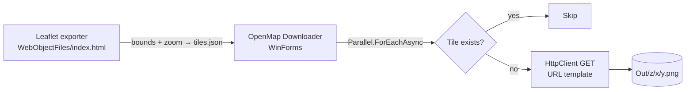

<div align="center">

# 🗺️ OpenMap

**Bulk map-tile downloader for offline maps — feed it tile coordinates and a URL template, get a ready-to-serve `z/x/y` tile tree.**

[](https://github.com/mr-aybee/open-map/actions/workflows/ci.yml)


[](LICENSE)

</div>

---

## Overview

OpenMap is a Windows desktop utility that downloads raster map tiles in parallel from any XYZ tile service you are authorised to use. A companion Leaflet page generates the list of tiles covering an area and zoom range, and the downloader fetches them into the standard `Out/<z>/<x>/<y>.png` layout used by Leaflet, OpenLayers and most offline map viewers.

## Features

- ⚡ **Parallel downloads** with a configurable degree of parallelism
- 🔁 **Resumable** — tiles that already exist on disk are skipped
- 🧩 **Any XYZ provider** — URL templates with `{x}`, `{y}` and `{z}` placeholders
- 🗂️ **Standard tile layout** — output works directly with Leaflet/OpenLayers
- 🌐 **Leaflet tile exporter** — select bounds and zoom levels in the browser to generate the tile list
- 📋 **Live progress log** with per-tile status

## How it works



## Tech stack

| Layer | Technology |
| --- | --- |
| Desktop UI | C# · Windows Forms · .NET 6 |
| Networking | Shared `HttpClient`, streamed responses |
| Concurrency | `Parallel.ForEachAsync` with cancellation |
| Tile selection | Leaflet + spherical-mercator tile math (JavaScript) |

## Getting started

### Prerequisites

- Windows 10/11
- [.NET 6 SDK](https://dotnet.microsoft.com/download/dotnet/6.0) (or Visual Studio 2022 with the .NET desktop workload)

### Build and run

```shell
git clone https://github.com/mr-aybee/open-map.git
cd open-map
dotnet build OpenMap.sln -c Release
dotnet run --project OpenMapDownloader
```

## Usage

1. Open `OpenMapDownloader/WebObjectFiles/index.html` in a browser, choose an area and zoom range, and export the tile list as JSON:

   ```json
   [{"x": 5821, "y": 3355, "z": 13}, {"x": 5822, "y": 3355, "z": 13}]
   ```

2. In OpenMap, click **Load JSON** and select the file.
3. Enter the tile URL template, for example `https://tiles.example.com/{z}/{x}/{y}.png`.
4. Set **Max parallelism** (keep it within your provider's rate limits) and click **Start**.
5. Tiles are written to `Out/<z>/<x>/<y>.png` next to the executable.

> ⚠️ Only download from tile providers whose terms permit bulk or offline use, and keep their attribution.

## Project structure

```text
open-map/
├── OpenMap.sln
└── OpenMapDownloader/
    ├── Program.cs            # WinForms entry point
    ├── Downloader.cs         # UI, parallel download pipeline, progress log
    ├── MapTile.cs            # {x, y, z} JSON model
    └── WebObjectFiles/       # Leaflet tile exporter (index.html, leafletExporter.js)
```

## Development

- Open `OpenMap.sln` in Visual Studio 2022 or run `dotnet build`.
- CI builds the solution on every push and pull request ([workflow](.github/workflows/ci.yml)).
- Keep the UI thread free: network and disk work belongs inside the parallel loop.

## Contributing

Contributions are welcome. Read [CONTRIBUTING.md](CONTRIBUTING.md) for the branch, build and pull-request workflow. Please report security issues privately through [GitHub security advisories](https://github.com/mr-aybee/open-map/security/advisories/new), not public issues.

## Code of Conduct

This project follows the [Contributor Covenant](CODE_OF_CONDUCT.md). By participating you agree to uphold it.

## License

Released under the [MIT License](LICENSE). © 2026 Abdullah Shahid.
